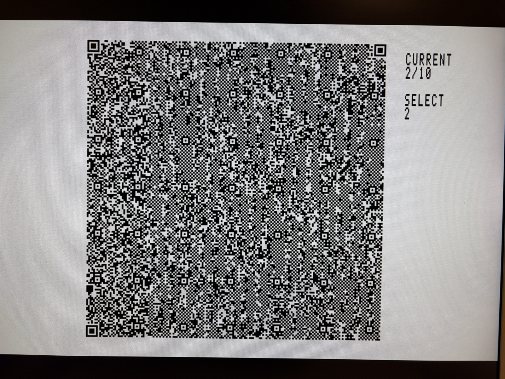

<p align="center">
  
</p>

# PC98QR

PC-98の画面にQRコードを表示し、スマートフォンで撮影することで、PC-98からWindows 11へバイナリファイルを転送する実験プロジェクトです。

RS-232CやLANなどを使用せず、ファイルを複数のQRコードに分割して転送し、Windows側で元のファイルとして復元します。

## 動作動画

実際にPC-98からMAG画像を転送・復元する様子をYouTubeで公開しています。

[PC-98のMAG画像をQRコードでWindows 11へ転送してみた](https://www.youtube.com/watch?v=Mym4FzP7OOM)

## ダウンロード

ビルド済みのPC-98用プログラムとWindows用復元ツールを、ZIP形式で配布予定です。

**[GitHub Releases](https://github.com/yarufu/PC98QR/releases)**

配布予定のファイル：

- `QRTEST.EXE` — PC-98用のQRコード表示・ファイル転送プログラム
- `restore-v2.bat` — QRコード写真をドラッグ＆ドロップして復元するWindows用BATファイル
- Windows用Pythonスクリプト — QRコードの読み取りとファイル復元に使用

Windows側ではPython 3と必要なライブラリを別途インストールしてください。

```powershell
python -m pip install opencv-python zxing-cpp
```

ソースコードからビルドする場合は、下記の「ビルド方法」を参照してください。

## 主な仕様

- QR Code Model 2 / Version 40 / ECC L（177×177 modules）
- QRコード1枚の最大容量：2,953 bytes（転送用ヘッダー等を含む）
- 複数QRコードへのファイル分割に対応
- バイナリデータを文字コード変換せずに転送
- 元のDOSファイル名で自動復元
- QRコードのフレーム番号を手動選択

## 動作環境

**PC-98側**

- NEC PC-9821Ra43（実機確認済み）
- PC-98版 MS-DOS 6.20
- 640×400ドット表示

**Windows側**

- Windows 11
- Python 3
- OpenCV（opencv-python）
- zxing-cpp

**ソースからのビルド環境**

- WSL Ubuntu
- ia16-elf-gcc（small memory model / V30互換）

## 使用方法

### 1. PC-98でQRコードを表示

`QRTEST.EXE`をPC-98へコピーし、MS-DOS上で実行します。

```text
QRTEST /M B:\TEST.MAG
```

`B:\TEST.MAG`は転送したいファイルのパスに変更してください。

`S`キーで転送を開始し、フレーム番号を入力してEnterキーでQRコードを切り替えます。終了はEscキーです。

### 2. QRコードを撮影

スマートフォンなどで、すべてのQRコードを撮影します。

撮影順序は問いませんが、異なるファイルのQR写真を混在させないでください。

### 3. Windowsでファイルを復元

**ドラッグ＆ドロップで復元**

撮影したQR画像をすべて選択し、`restore-v2.bat`へまとめてドラッグ＆ドロップします。

正常に読み取れれば、BATファイルと同じフォルダに元のファイル名で復元されます。

**コマンドラインで復元**

```powershell
python windows\reassemble_photos.py C:\Photos\QR01.jpg C:\Photos\QR02.jpg C:\Photos\QR03.jpg
```

復元先は現在の作業ディレクトリです。

既存の同名ファイルは上書きしません。

## ビルド方法

PC-98用の実行ファイルを生成するには、`ia16-elf-gcc`が必要です。

```bash
make all
```

生成ファイル：`build/QRTEST.EXE`

ビルド時には、導入済みツールチェーンのリンカー設定から、V30互換のNOP paddingを使用する設定を生成します。未知の形式ではビルドを停止します。

ビルド済みEXEはソースリポジトリには含めず、Releasesでの配布を予定しています。

### host tests

host testsの実行には、Python 3.11以上とホスト用Cコンパイラー（GCCなど）が必要です。Python 3.12で動作確認しています。

```bash
python3 -m venv .venv
source .venv/bin/activate
python -m pip install -r requirements-host.txt

make test
```

## 実機での確認結果

PC-9821Ra43で、29,198 bytesの`TEST.MAG`を10枚のQRコードに分割して転送しました。

スマートフォンで撮影した画像からWindows 11で復元し、元ファイルとのSHA-256完全一致を確認しています。

復元したMAGファイルをPC-98へ戻し、画像を正常に表示できることも確認しました。

また、GitHub公開用に選別したソースから再ビルドしたEXEでも、実機転送とWindows側での復元に成功しています。ドラッグ＆ドロップ対応BATによる復元も確認済みです。

**公開用ソースの検証結果**

| 項目 | 結果 |
|---|---|
| ia16 build | 成功 |
| QRTEST.EXE | 16,864 bytes |
| host tests | 1,152件成功（failure / error / skip：0） |
| 既存EXEとのSHA-256比較 | 完全一致 |

## 制限事項

- QRコードの切り替えと撮影は手動です。
- Webカメラによる自動連続受信には未対応です。
- ファイル名は所定のASCII文字によるDOS 8.3形式に制限されます。
- 転送ごとの識別子やファイル全体のCRCはありません。
- 異なる転送のQR写真を混在させないでください。
- 古いPC-98やCRTなど、すべての環境での動作は未確認です。
- 大容量ファイルはhost testsで検証していますが、すべてのサイズについて実機転送を確認したわけではありません。

実験的なソフトウェアのため、重要なデータは復元後にSHA-256などで一致を確認してください。

## QR encoderについて

QR encoderは、QRコードの規格と数学に基づく独立実装です。

外部のQR encoderは、テスト時の比較・検証にのみ使用しています。

## ライセンス

MIT License

詳細は[LICENSE](LICENSE)を参照してください。

外部ツールチェーンやPythonライブラリには、それぞれのライセンスが適用されます。
